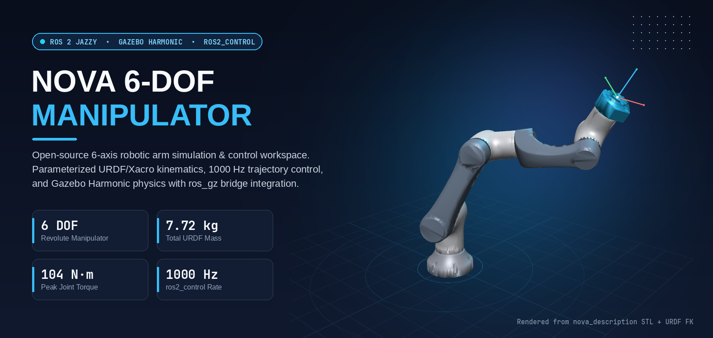
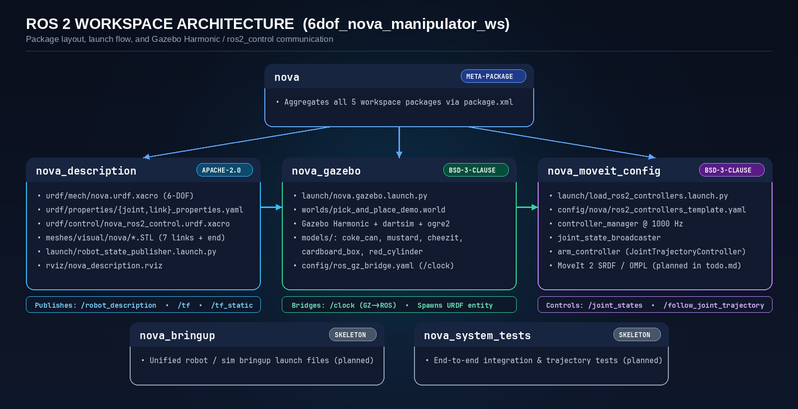
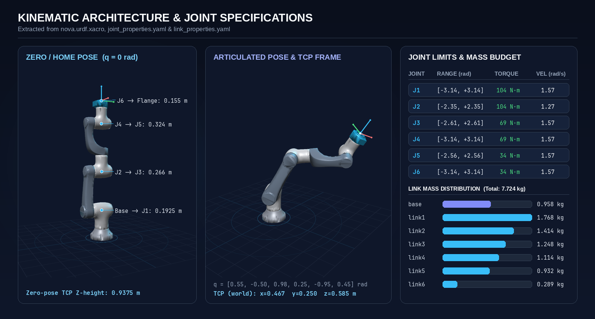

<div align="center">



# 🤖 Nova 6-DOF Manipulator (`Manipulator-ROS2`)

**Modular ROS 2 simulation, parameterized URDF/Xacro modeling, and `ros2_control` trajectory execution workspace for the 6-axis Nova robotic arm.**

[](https://releases.ubuntu.com/noble/)
[](https://docs.ros.org/en/jazzy/)
[](https://gazebosim.org/)
[](https://control.ros.org/)
[](LICENSE)

[Overview](#-overview) •
[Architecture](#-workspace-architecture) •
[Kinematics & Specs](#-kinematics--specifications) •
[Quick Start](#-installation--build) •
[Usage](#-usage--launch-guide) •
[Roadmap](#-roadmap--known-issues)

</div>

---

## ✨ Overview

**Manipulator-ROS2** provides a clean, modular ROS 2 Jazzy package suite for simulating, visualizing, and controlling the **Nova** 6-DOF articulated robotic manipulator.

### Key Highlights
- **Parameterized URDF/Xacro Description (`nova_description`)**: Supports custom `robot_name` prefixes for multi-robot setups, configurable base/flange links, and YAML-driven inertia, mass, origin, and joint limit definitions.
- **High-Fidelity CAD Meshes**: Includes 7 STL link meshes (`nova_base` through `nova_link6`, plus `nova_end_link`) with exact link masses and inertia tensors.
- **Gazebo Harmonic Integration (`nova_gazebo`)**: Launches `ros_gz_sim` with a `pick_and_place_demo.world` scene (`red_cylinder`, `mustard`, `cheezit_big_original`, `cardboard_box`, `coke_can`) and bridges `/clock` via `ros_gz_bridge`.
- **1000 Hz `ros2_control` Pipeline (`nova_moveit_config`)**: Dynamically generates robot-specific controller configurations from `ros2_controllers_template.yaml` and sequentially spawns `joint_state_broadcaster` and `arm_controller` (`JointTrajectoryController`) matching Gazebo's 1000 Hz physics step.

---

## 🧩 Workspace Architecture

<div align="center">
  
</div>

### Packages Overview

| Package | Role & Contents | Status | License |
| :--- | :--- | :---: | :---: |
| **`nova`** | Meta-package aggregating all Nova workspace packages | Active | `BSD-3-Clause` |
| **`nova_description`** | Parameterized `nova.urdf.xacro`, YAML joint/link properties, STL meshes, `ros2_control` tags, RViz & `robot_state_publisher` launch | Active | `Apache-2.0` |
| **`nova_gazebo`** | Gazebo Harmonic launch, `pick_and_place_demo.world`, 5 SDF demo objects, `ros_gz_bridge` & camera bridge configs | Active | `BSD-3-Clause` |
| **`nova_moveit_config`** | `ros2_controllers_template.yaml` (1000 Hz) & sequential controller spawner (`load_ros2_controllers.launch.py`) | Partial *(MoveIt 2 configs planned)* | `BSD-3-Clause` |
| **`nova_bringup`** | Unified hardware/simulation bringup launch files | Skeleton *(Planned)* | `BSD-3-Clause` |
| **`nova_system_tests`** | Automated integration and trajectory verification tests | Skeleton *(Planned)* | `BSD-3-Clause` |

---

## 📐 Kinematics & Specifications

<div align="center">
  
</div>

All kinematic offsets, joint limits, and inertial parameters are decoupled from the Xacro templates into [`joint_properties.yaml`](nova_description/urdf/properties/joint_properties.yaml) and [`link_properties.yaml`](nova_description/urdf/properties/link_properties.yaml).

### Joint Specifications

Every active joint is a `revolute` joint rotating about its local `Z`-axis with shared dynamics (`damping = 1.5`, `friction = 0.3`):

| Joint | Parent → Child | Origin `xyz` (m) | Origin `rpy` (rad) | Lower (rad) | Upper (rad) | Peak Torque (N·m) | Max Velocity (rad/s) |
| :---: | :--- | :--- | :--- | :---: | :---: | :---: | :---: |
| **`joint1`** | `base` → `link1` | `0, 0, 0.1925` | `0, 0, 0` | `-3.14` | `+3.14` | `104` | `1.57` |
| **`joint2`** | `link1` → `link2` | `0, 0, 0` | `1.5708, 0, 0` | `-2.35` | `+2.35` | `104` | `1.27` |
| **`joint3`** | `link2` → `link3` | `0, 0.266, 0` | `3.1416, 0, 1.5708` | `-2.61` | `+2.61` | `69` | `1.57` |
| **`joint4`** | `link3` → `link4` | `0, 0, 0` | `1.5708, 0, 1.5708` | `-3.14` | `+3.14` | `69` | `1.57` |
| **`joint5`** | `link4` → `link5` | `0, 0, 0.324` | `-1.5708, 0, 0` | `-2.56` | `+2.56` | `34` | `1.57` |
| **`joint6`** | `link5` → `link6` | `0, 0, 0` | `+1.5708, 0, 0` | `-3.14` | `+3.14` | `34` | `1.57` |
| **`end_joint`** *(fixed)* | `link6` → `end_link` | `0, 0, 0.155` | `0, 0, 0` | — | — | — | — |

### Link Mass Breakdown
- **Base (`nova_base`)**: `0.958 kg`
- **Moving Arm (`nova_link1` – `nova_link6`)**: `1.768 + 1.414 + 1.248 + 1.114 + 0.932 + 0.289 = 6.766 kg`
- **Total Robot Mass**: **`7.724 kg`**
- **Zero-Pose Flange Height (`q = 0`)**: **`0.9375 m`** above `world`

---

## 🚀 Installation & Build

### Prerequisites
- **OS**: Ubuntu 24.04 LTS (Noble Numbat)
- **ROS 2**: [ROS 2 Jazzy Jalisco](https://docs.ros.org/en/jazzy/Installation.html)
- **Simulator**: Gazebo Harmonic (`ros_gz_sim`, `ros_gz_bridge`, `ros_gz_image`)
- **Control**: `ros2_control`, `ros2_controllers`, `gz_ros2_control`

### Clone & Build

```bash
# 1. Create a ROS 2 workspace and clone the repository into src/
mkdir -p ~/nova_ws/src
cd ~/nova_ws/src
git clone https://github.com/mahdi99250/Manipulator-ROS2.git
cd ~/nova_ws

# 2. Source ROS 2 Jazzy
source /opt/ros/jazzy/setup.bash

# 3. Install workspace dependencies
rosdep update
rosdep install --from-paths src --ignore-src -r -y

# 4. Build all packages
colcon build --symlink-install

# 5. Source the workspace overlay
source install/setup.bash
```

---

## 🎮 Usage & Launch Guide

### 1. Visualize in RViz2 (`nova_description`)

Launch `robot_state_publisher`, `joint_state_publisher_gui`, and `rviz2` to inspect the URDF model and test joint ranges interactively:

```bash
ros2 launch nova_description robot_state_publisher.launch.py
```

<details>
<summary><b>View all launch arguments for <code>robot_state_publisher.launch.py</code></b></summary>

| Argument | Default | Description |
| :--- | :--- | :--- |
| `robot_name` | `nova` | Prefix & name of the robot |
| `add_world` | `true` | Attach a fixed `world` root link (`true` / `false`) |
| `base_link` | `<robot_name>_base_link` | Base link frame name |
| `flange_link` | `<robot_name>_end_link` | End-effector flange link frame name |
| `use_gazebo` | `false` | Load `gz_ros2_control` plugin & Gazebo hardware interface |
| `use_camera` | `false` | Enable camera flag passed to Xacro |
| `controllers_file` | `""` | Custom `ros2_controllers.yaml` path (auto-generated from template if empty) |
| `use_jsp` | `true` | Start `joint_state_publisher` |
| `jsp_gui` | `true` | Use `joint_state_publisher_gui` when `use_jsp:=true` |
| `use_rviz` | `true` | Launch RViz2 |
| `use_sim_time` | `false` | Use `/clock` simulation time |

</details>

---

### 2. Launch Gazebo Harmonic Simulation (`nova_gazebo`)

Start Gazebo Harmonic with `pick_and_place_demo.world`, spawn the Nova manipulator, bridge `/clock`, and automatically load `joint_state_broadcaster` + `arm_controller` after spawning:

```bash
ros2 launch nova_gazebo nova.gazebo.launch.py
```

Launch with custom spawn pose or without RViz:

```bash
ros2 launch nova_gazebo nova.gazebo.launch.py \
  use_rviz:=false \
  x:=0.0 y:=0.0 z:=0.0 \
  world_file:=pick_and_place_demo.world
```

<details>
<summary><b>View all launch arguments for <code>nova.gazebo.launch.py</code></b></summary>

| Argument | Default | Description |
| :--- | :--- | :--- |
| `robot_name` | `nova` | Robot entity name & joint prefix |
| `world_file` | `pick_and_place_demo.world` | World filename inside `nova_gazebo/worlds/` |
| `use_gazebo` | `true` | Launch `ros_gz_sim` & parameter bridge |
| `load_controllers` | `true` | Sequentially spawn controllers after entity creation |
| `use_robot_state_pub` | `true` | Include `robot_state_publisher.launch.py` |
| `use_rviz` | `true` | Launch RViz2 alongside Gazebo |
| `use_jsp` / `jsp_gui` | `false` | Disabled automatically when `load_controllers:=true` to prevent `/joint_states` conflict |
| `use_camera` | `false` | Enable `ros_gz_bridge` & `ros_gz_image` camera topics |
| `use_sim_time` | `true` | Synchronize nodes with Gazebo `/clock` |
| `x`, `y`, `z` | `0.0, 0.0, 0.05` | Initial spawn position (meters) |
| `roll`, `pitch`, `yaw` | `0.0, 0.0, 0.0` | Initial spawn orientation (radians) |

</details>

---

### 3. Verify & Command `ros2_control` Trajectory

Check that both controllers are active:

```bash
ros2 control list_controllers
```

Expected output:
```text
joint_state_broadcaster[joint_state_broadcaster/JointStateBroadcaster] active
arm_controller[joint_trajectory_controller/JointTrajectoryController]  active
```

Send a smooth joint trajectory goal to `/arm_controller/follow_joint_trajectory`:

```bash
ros2 action send_goal /arm_controller/follow_joint_trajectory \
  control_msgs/action/FollowJointTrajectory \
  "{
    trajectory: {
      joint_names: [nova_joint1, nova_joint2, nova_joint3, nova_joint4, nova_joint5, nova_joint6],
      points: [
        { positions: [0.45, -0.50, 0.98, 0.25, -0.95, 0.45], time_from_start: { sec: 3, nanosec: 0 } }
      ]
    }
  }"
```

---

## 📁 Repository Structure

```text
Manipulator-ROS2/
├── docs/
│   └── images/                        # High-res STL renders & architecture diagrams
├── nova/                              # Meta-package
├── nova_bringup/                      # Unified bringup launch package (planned)
├── nova_description/
│   ├── launch/                        # robot_state_publisher.launch.py
│   ├── meshes/visual/nova/            # STL meshes (base, link1..link6, end_link)
│   ├── rviz/                          # nova_description.rviz
│   └── urdf/
│       ├── control/                   # ros2_control & gz_ros2_control macros
│       ├── mech/                      # nova.urdf.xacro, macros.xacro, materials.xacro
│       └── properties/                # joint_properties.yaml & link_properties.yaml
├── nova_gazebo/
│   ├── config/                        # ros_gz_bridge.yaml & ros_gz_camera_bridge.yaml
│   ├── launch/                        # nova.gazebo.launch.py
│   ├── models/                        # cardboard_box, cheezit, coke_can, mustard, red_cylinder
│   └── worlds/                        # pick_and_place_demo.world
├── nova_moveit_config/
│   ├── config/nova/                   # ros2_controllers_template.yaml (1000 Hz)
│   └── launch/                        # load_ros2_controllers.launch.py
├── nova_system_tests/                 # Integration & system test suite (planned)
├── todo.md                            # Detailed engineering bug & refactoring tracker
└── LICENSE                            # Apache-2.0
```

---

## 🛠 Roadmap & Known Issues

Active development and known simulation issues are tracked in [`todo.md`](todo.md). Upcoming milestones include:

- [ ] **Gazebo Harmonic (`dartsim`) Collision Primitives**: Replace STL/DAE `<collision>` meshes with primitive shapes (`cylinder` / `box`) in `nova.urdf.xacro` and demo object SDFs.
- [ ] **Simulation World Fixes**: Align spawn height (`z = 0.0`), make `mustard` dynamic with realistic scale/inertia, fix `red_cylinder` inertia, and replace remote `Sun` Fuel URI with a local directional light.
- [ ] **MoveIt 2 Configuration**: Add `nova.srdf`, `kinematics.yaml`, `joint_limits.yaml`, `ompl_planning.yaml`, and `move_group.launch.py` inside `nova_moveit_config`.
- [ ] **Hardware & Sensor Support**: Add `mock_components/GenericSystem` fallback when `use_gazebo:=false` and implement the RGB-D camera sensor macro for `use_camera:=true`.
- [ ] **Launch Refactoring & Lint Compliance**: Separate `display.launch.py` from `robot_state_publisher.launch.py`, implement `nova_bringup` and `nova_system_tests`, and resolve `ament_flake8` / `ament_pep257` / `lint_cmake` checks.

---

## 👤 Maintainer & License

- **Maintainer**: Mahdi Momeni ([@mahdi99250](https://github.com/mahdi99250)) — `mahdimomeni178@gmail.com`
- **Licensing**: Root repository and `nova_description` are licensed under **Apache-2.0** ([`LICENSE`](LICENSE)); `nova`, `nova_gazebo`, `nova_moveit_config`, `nova_bringup`, and `nova_system_tests` carry **BSD-3-Clause** package licenses.
